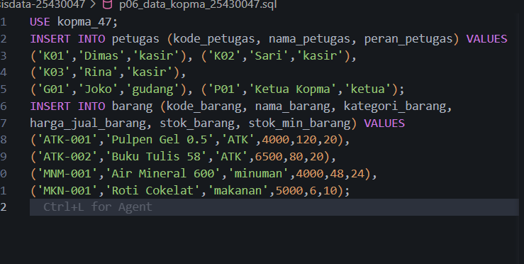
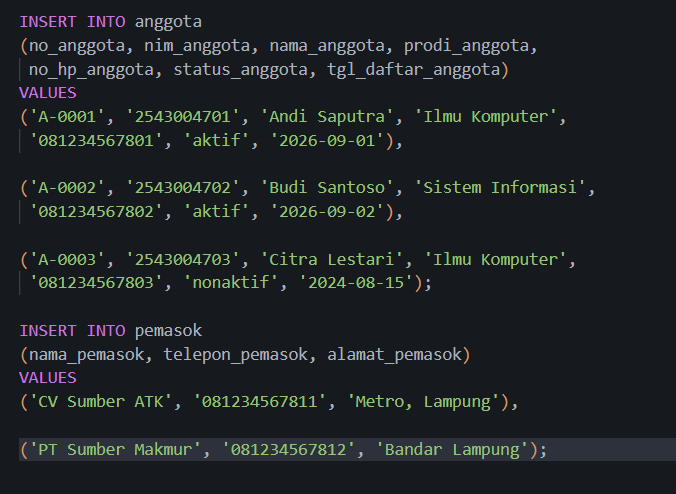
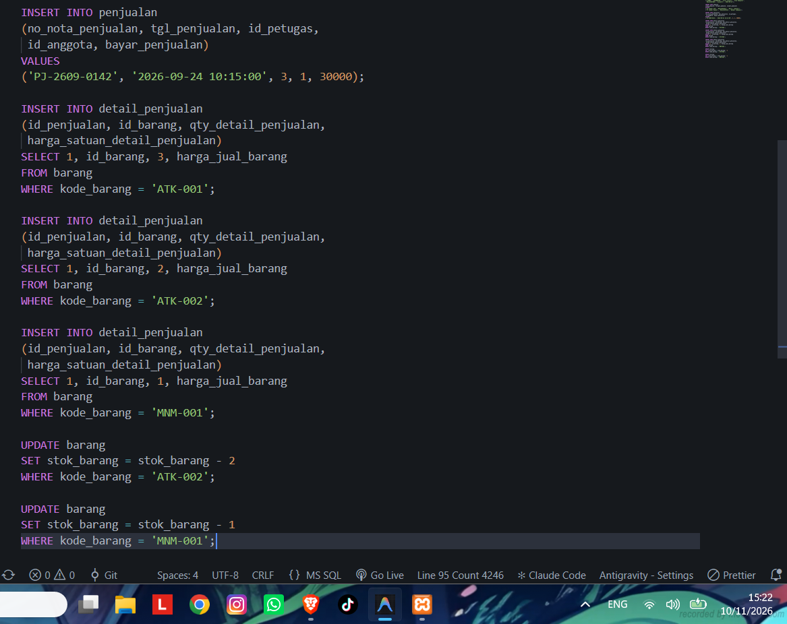
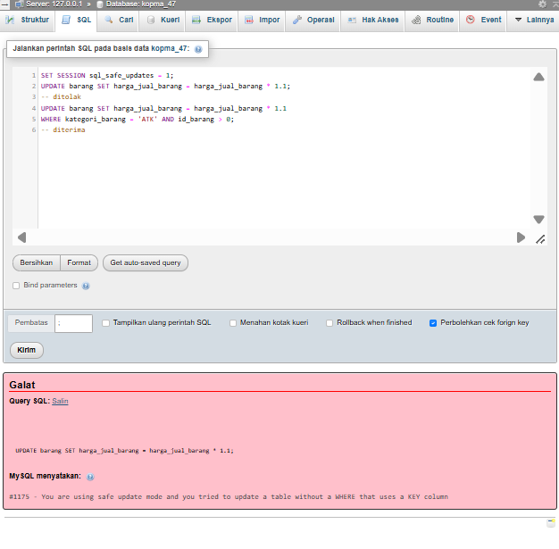
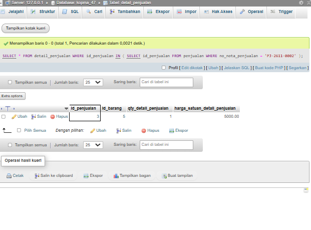
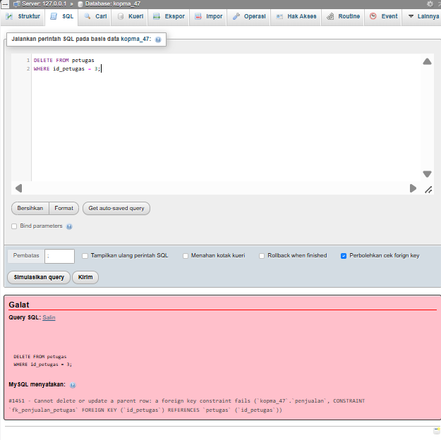

# Laporan Praktikum Basis Data - Pertemuan 06

**Nama:** Vicky Pradana
**NIM:** 25430047
**Kelas:** B
**Tanggal:** 10 Novenber 2026
**Nama Dosen:** Dedi Irawan, S.Kom., M.T.I.

## 1. Tujuan Praktikum
mahasiswa mampu dan bisa nambah data pake insert dan insert..select, bisa ubah dan apus data pake update dan delate dengan aman pake mode sql_safe_updates;, nyusun dan mencatat skenario uji positif dan negatif hasil nya , nyiapkan juga data sempel yg bisa di buangan ulang dari skrip

## 2. Ringkasan Dasar Teori
DML (data manipulation language) beruapa INSERT, UPDATE, DELETE, SELECT.karna adanya kunci tamu untuk uratannya ngikutin pembutan table , jadi induk dulu baru anak , uratan hapusnya dibalik kecuali relasi nya tu pake ON DELETE CASCADE.
ADA BAHAYA UPDATE DAN DELETE Tampa WHERE! 
tampe whare mengenai semua baris. ini sering terjadi 
tapi tidak muncul kode galat , Variable sql_safe_update bikin server nolak perintah kecuali Where pake kolom kunci/ sertai LIMIT. kita juga harus menguji basis data gk cuma berherti buat btable aja kita perliu pengujian juga uji postif data kudu benar dan uji negatif data harus di tolak serta kode galat tepat  

## 3. Hasil Langkah Percobaan

### D.1 Mengisi Data Induk

### D.2 Mencatat Nota Penjualan

### D.3 Mengubah dan Menghapus dengan Aman

### D.4 Menurunkan Entitas Kandidat dan Aturan Bisnis

### D.5 Kebutuhan Informasi dan Matriks CRUD

### D.6 Kamus Data Awal dan Kebutuhan Non-Fungsional

### D.7 Menulis Dokumen Kebutuhan Data

## 4. Jawaban Titik Analisis
Titik Analisis: 1
Perintah INSERT ... SELECT di atas mengambil harga dari tabel barang. Mengapa
cara ini lebih aman daripada mengetik angka 4000 secara manual? Setelah harga pulpen
naik menjadi Rp4.500 minggu depan, apakah nota PJ-2609-0142 ikut berubah?

karna pernatah ini lebih INSERT...SELECT lebih aman krna harga satuuan diambil langsung di kolom harga_jual_barang pd tabel barang. dengan ini harga yg si masukan ke detail sesuai dengan harga yg di simpen di database ngurangi kesalahan ngetik angka manual.
jika harga nya naik jadi 4.500k mingdep nota nya gk berubah karna harga pas transaksi dah di simpan di di kolom harga_satuan_detail_penjualan.

Titik Analisis: 2
Menghapus nota menghapus detailnya, tetapi menghapus petugas ditolak. Jelaskan kedua
perilaku ini dari definisi constraint di Modul 5. Bagaimana cara yang benar jika seorang
kasir berhenti bekerja?

kolo menghapus nota, detail penjualan ikut ke apus karna relasi FK pake ON DELETE CASCADE itu membuat data penjualan bisa di apus dan semual yg terhubung bisa ikut otomatis ke apus. ngapus petugas di tolak ? karna FK pake ON DELETE RESTRICT berarti petugas gk boleh di apus selama masih ada data penjulaan yg nyambung ke dengan nya 
cara yg bener itu kolo kasir berhenti kerja adalah ubah status petugas jadi nonaktif bukan apus datanya. 

Titik Analisis: 3
Semua uji di atas akan berstatus LULUS. Tuliskan satu uji yang Anda perkirakan GAGAL
karena aturan bisnisnya belum dijaga server, misalnya penjualan yang qty-nya melebihi
stok (AB-03). Mengapa constraint CHECK di tabel barang tidak mencegahnya
kita coba pengujian ini :
- Stok pulpen (AB-3): 5 buah 
- Jumlah yg dijual : 10 buah 
- Hasil yg di harapkan , penjualan ditolak karna jumlah barang yg di jual melebihi stok teredia

Constraint CHECK di tabel barang ogk menghalang hal itu karan constraint itu hanya memeriksa nilai pd tabel barang , misalnya stok_brang >= 0 constraint gk otomatis membandingkan jumalah barang yg di jual pd table deatail_penjualan , oleh karna itu perlu di lakaukan pemeriksaan stokk saaat proses penjulaan dilakukan biar gk melebihi stokk 

## 5. Hasil Latihan dan Modifikasi

## 6. Tugas Mandiri: Milestone Proyek 2

## 7. Pembahasan dan Kendala

## 8. Kesimpulan

## 9. Pernyataan Penggunaan AI
di sini saya menggunakan ai pada modul 6 ini bagian titik analis lalu ada di bagian latihan dan modifikasi serta tugas mandiri dimana ai membantu untuk mengarahkan step bye step bagaimana saya harus mulai mengrjakannya dan  ai yg saya gunakan GPT Go 

## 10. Bukti Git

## Checklist

