# Laporan Praktikum Basis Data - Pertemuan 07
**Nama:** Vicky Pradana
**NIM:** 25430047
**Kelas:** B
**Tanggal:** 18 November 2026
**Nama Dosen:** Dedi Irawan, S.Kom., M.T.I.

## 1. Tujuan Praktikum
mahasiswa mampu, bisa ambil data pakai perintah select dengan pilih kolom ,kasih nama, dan ngilangkan data duplikat (distinct); nyaring baris data dari keriteria tertentu(BETWEEN,IN,LIKE dan IS NULL), ngatur urutan dan membatasi jumlah baris yg tampil(ORDER BY da LIMIT) serta bisa mengolah , memformat, dan pakai fungsi skalar

## 2. Ringkasan Dasar Teori
SELECT di tuli dengan urutan yg SELECT-FROM-WHARE-ORDER-BY-LIMIT, jika dievaluasi secara logis urutannya yg beda  ini bisa buat alias kolom tidak bisa pakai di where karna aliasa baru buat setalah where di proses

kelasalaaha ada 2 di SELECT : langsung ke tolak sever (galat)dan kesalahan sematik kueri jalan hasilnya salah. yg fatal itu kesalahan sematik gk ada errornya 
ini fugsi skalarnya 
String: CONCAT, UPPER, LEFT, LENGTH
tgl: DATE_FERMAT, DATEDIFF, CURDATE, YEAR
Numerik: ROUND, FLOOR, ABS 
Kondisinal: IF , IFNULL, CASE

## 3. Hasil Langkah Percobaan

### D.1 Proyeksi dan Penyaringan

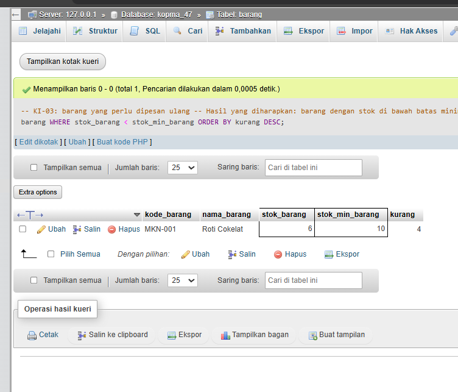
hasilnya Roti Cokelat (MKN-001) kurang 4 stok dari batas minimum 10

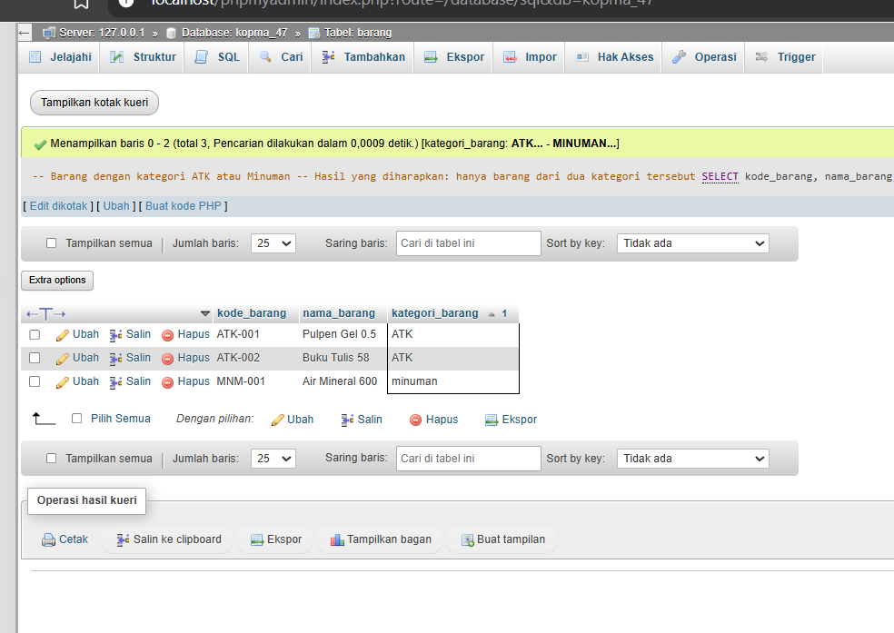
hasilnya 3 barang yaitu Pulpen Gel 0.5, Buku Tulis 58, dan Air Mineral 600

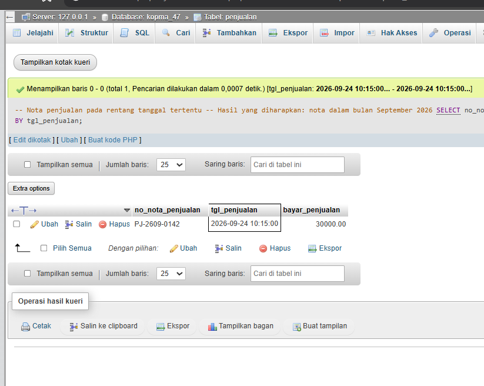
hasilnya 1 nota yaitu PJ-2609-0142 tanggal 2026-09-24

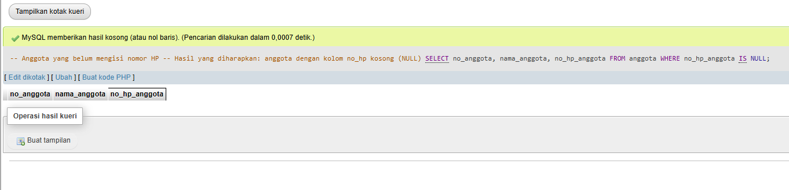
hasilnya kosong (0 baris), artinya semua anggota sudah punya nomor HP

### D.2 Pola Teks dan Nilai Kosong

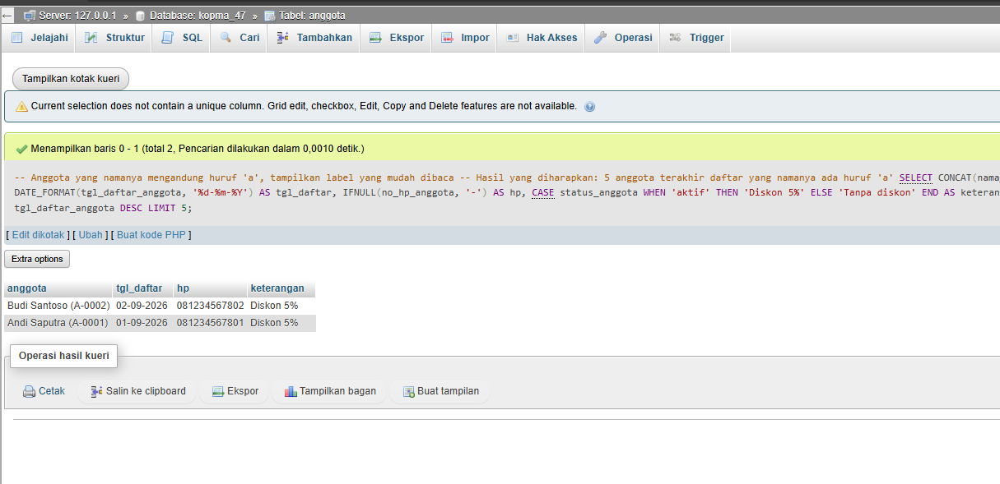
nampilin hasil data anggota yg nama nya ada huruf a pake LIKE , kasih fungsi skalar untuk format tampilanya

### D.3 Tanggal dan Perhitungan per Baris

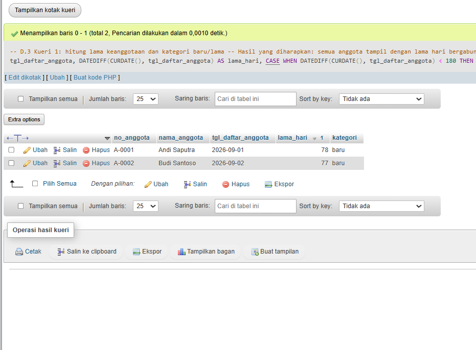
hasilnya kedua anggota masuk kategori baru (78 dan 77 hari)

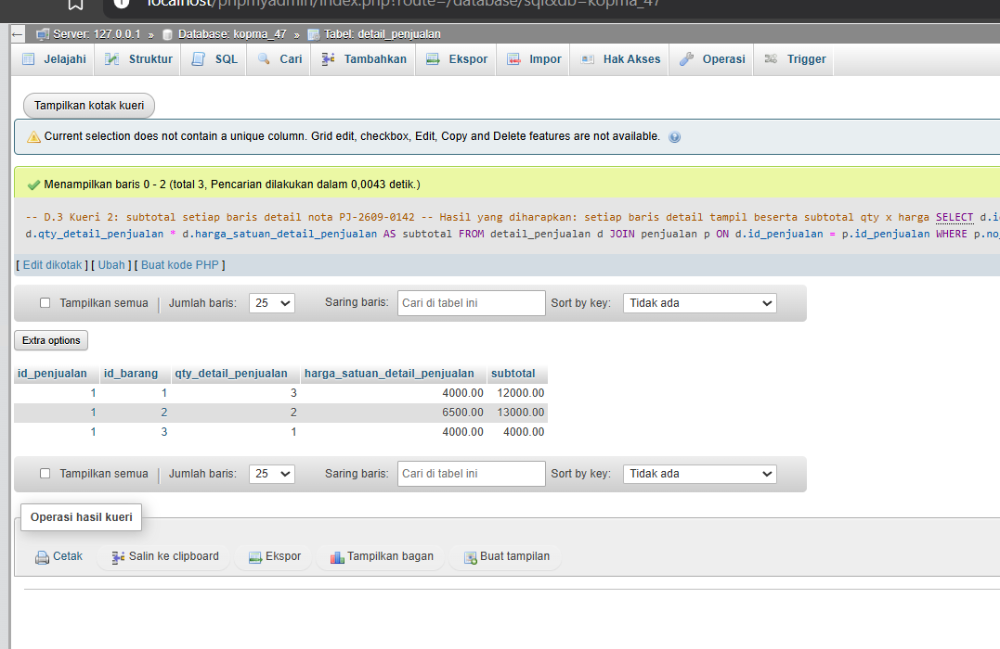
hasilnya ada 3 item dengan total masing-masing 12.000, 13.000, dan 4.000

## 4. Jawaban Titik Analisis

### Titik Analisis D.1
Ganti ORDER BY kurang menjadi WHERE kurang > 0. Catat galat yang muncul dan
jelaskan dengan urutan evaluasi pada Gambar 7.1. Bagaimana menulis syarat yang setara
tanpa memakai alias?
Galat yang muncul:
ERROR 1054 (42S22): Unknown column 'kurang' in 'where clause'

Urutan evaluasi logis kueri SQL adalah:
FROM → WHERE → GROUP BY → HAVING → SELECT → ORDER BY → LIMIT

Syarat yang setara tanpa alias:
WHERE (stok_min_barang - stok_barang) > 0
-- atau cukup:
WHERE stok_barang < stok_min_barang

### Titik Analisis D.2
Mengapa WHERE no_hp_anggota = NULL tidak pernah mengembalikan baris,
padahal ada anggota tanpa nomor HP? Tulis kueri yang benar, lalu jelaskan perbedaan NULL
dengan string kosong ''.

WHERE no_hp_anggota = NULL gk mengembalikan baris karena NULL gk bisa dibandingkan menggunakan operator =. SQL menghasilkan nilai UNKNOWN, sehingga baris tidak ditampilkan.

Kueri yg benar:
SELECT no_anggota, nama_anggota, no_hp_anggota
FROM anggota
WHERE no_hp_anggota IS NULL;

Perbedaannya:
- NULL: Menandakan data tidak memiliki nilai atau belum diisi.
- '': String kosong, yaitu nilai teks yang ada tetapi tidak memiliki karakter.

NULL diperiksa dengan IS NULL, sedangkan string kosong diperiksa dengan = ''

### Titik Analisis D.3
Subtotal per baris dapat dihitung di modul ini, tetapi total nota belum. Mengapa? Fitur
SQL apa yang dibutuhkan untuk menjumlahkan banyak baris menjadi satu nilai?
(Jawabannya dipelajari di Pertemuan 9.)

Subtotal (qty harga_satuan) hanya menghitung nilai setiap baris, Untuk menghitung total nota, sql yg di diperlukan fungsi agregat SUM() untuk menjumlahkan seluruh subtotal, dengan GROUP BY untuk mengelompokkan berdasarkan nomor nota

## 5. Hasil Latihan dan Modifikasi (E)

### E.1
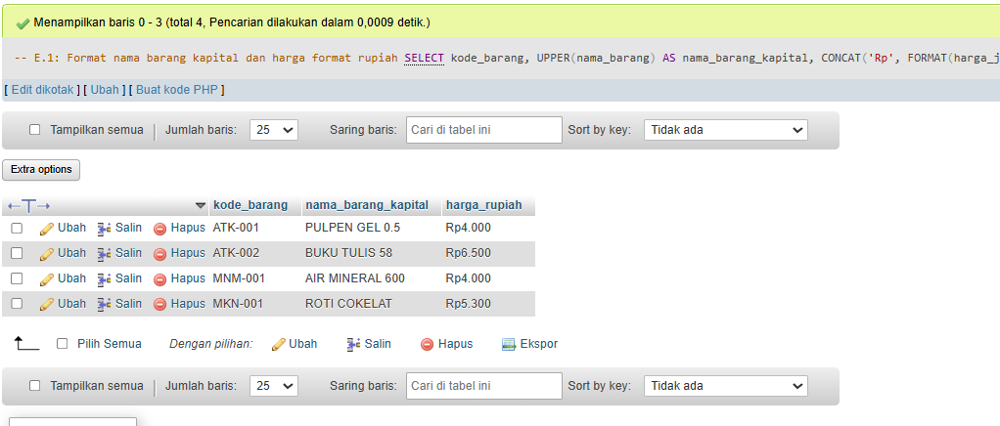
hasil nama barang jadi huruf kapital pakai UPPER dan harga jadi format rupiah pakai CONCAT dan FORMAT

### E.2
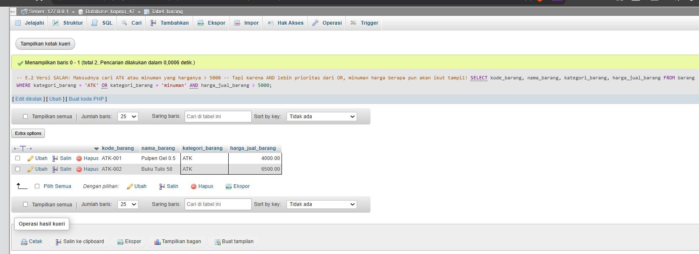
kueri yg salah semantik gk ada kurung, pulpen harga 4.000 ikut tampil padahal maunya harga 5000

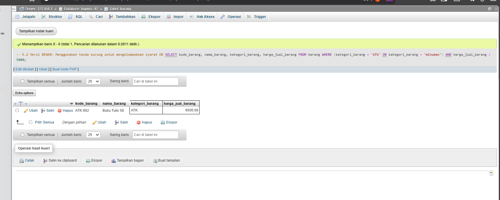
kueriyg benar pake tanda kurung pada OR, yg tampil hanya buku tulis harga 6.500

## 6. Tugas Mandiri: Milestone Proyek 7

### Kueri 01 (Mendukung KI-03)
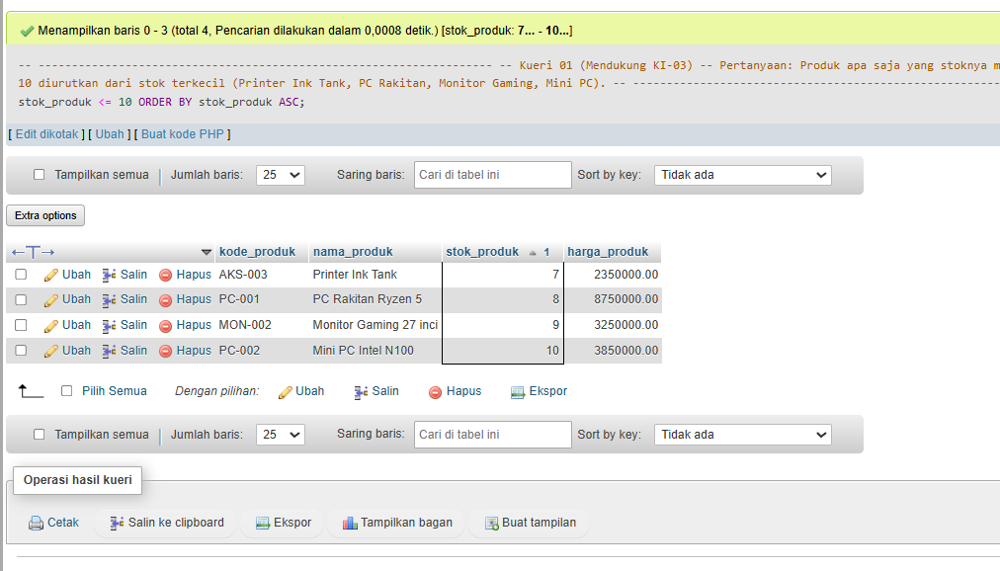
filter produk dengan stok <= 10, tampil 4 produk yang stoknya menipis dan perlu restock

### Kueri 02 (Pola Teks LIKE)
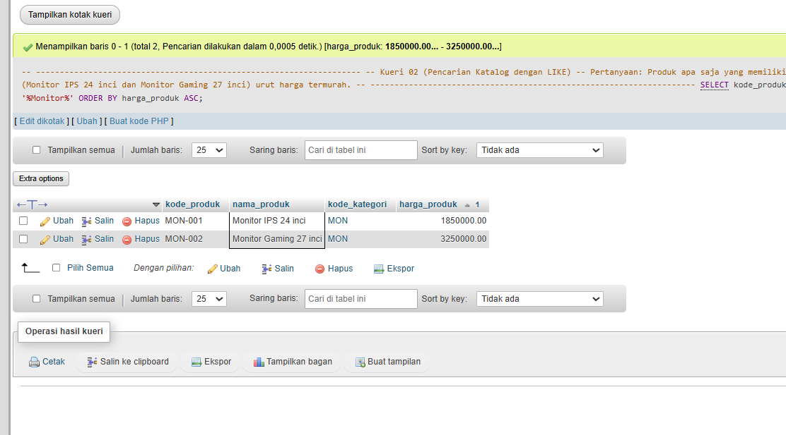
cari produk yang ada kata 'Monitor' di namanya, tampil 2 jenis monitor urut harga termurah

### Kueri 03 (Multi Kategori IN)
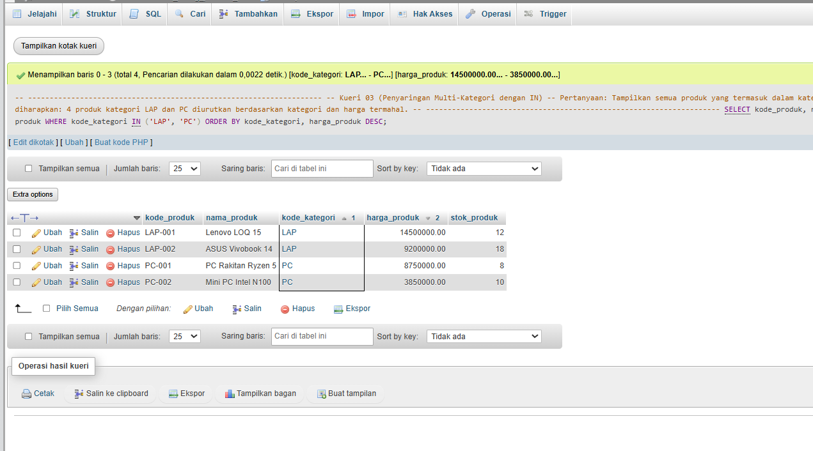
filter produk dalam kategori Laptop ('LAP') atau Komputer PC ('PC'), tampil 4 produk

### Kueri 04 (Rentang Tanggal BETWEEN)
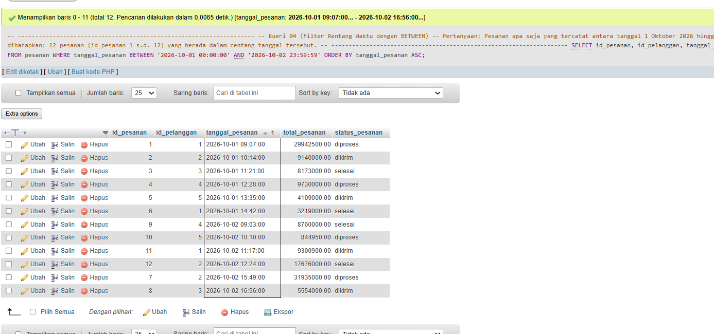
filter pesanan tanggal 1 sampai 2 Oktober 2026, tampil 12 transaksi pesanan

### Kueri 05 (Pengecekan IS NOT NULL)
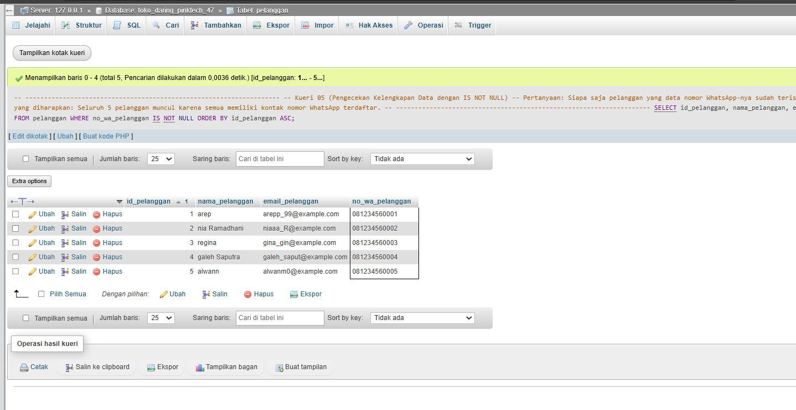
cek pelanggan yang nomor WA-nya sudah terisi lengkap (tidak NULL), tampil semua 5 pelanggan

### Kueri 06 (Logika Kondisional CASE)
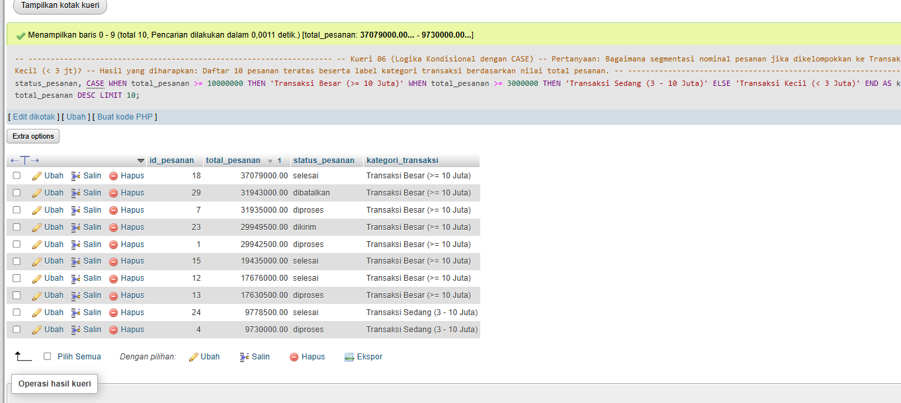
klasifikasi nominal pesanan ke Transaksi Besar, Sedang, dan Kecil pakai CASE

### Kueri 07 (Fungsi String UPPER, CONCAT, FORMAT)
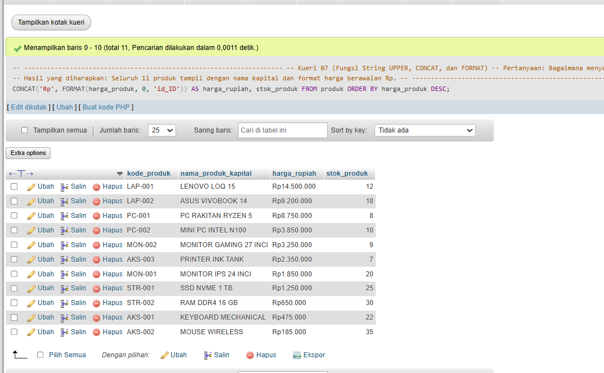
nama produk jadi huruf kapital dan harga diformat jadi rupiah 'Rp'

### Kueri 08 (Fungsi Tanggal DATE_FORMAT)
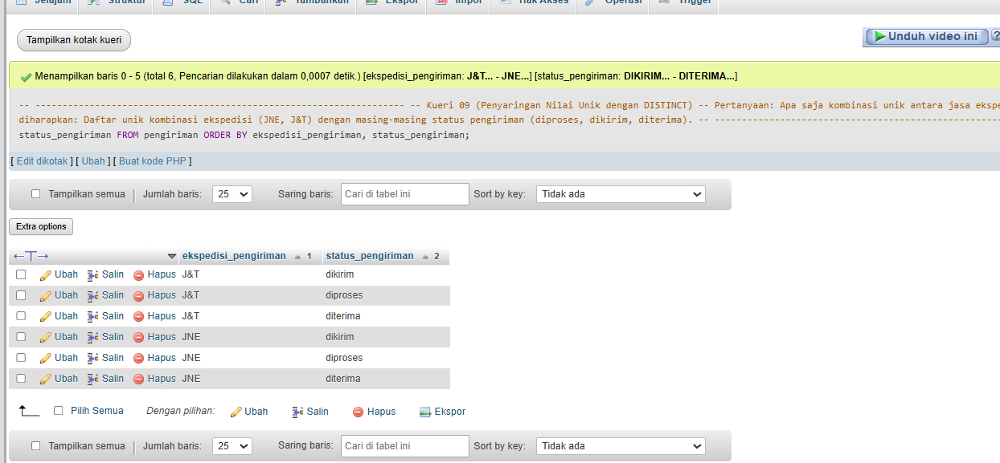
format tanggal pembayaran berhasil menjadi format baku Indonesia (DD/MM/YYYY jam:menit)

### Kueri 09 (Nilai Unik DISTINCT)
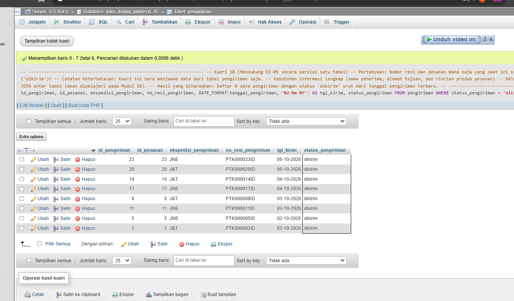
menampilkan kombinasi unik ekspedisi (JNE, J&T) dan status pengiriman tanpa duplikasi

### Kueri 10 (Mendukung KI-05 Parsial Satu Tabel)
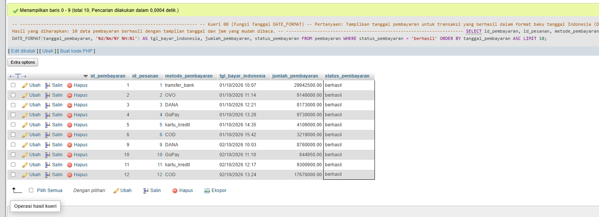
lacak pesanan yang statusnya 'dikirim' (keterbatasan: belum ada nama & barang karena butuh JOIN di modul 10)

## 7. Pembahasan dan Kendala
Jadi untuk md 7 menurut ku ini ada yang dialami yang dijalani saat jalanin query-nya. Kalau nggak salah di rangka yang D. Yang di D itu kan mau nampilin subtotal penjualan total, tapi ada error di galat 1054. Ternyata saya dicek lagi toh, udah kayak deskrip detail penjualan, kolom ID detail penjualan itu memang nggak ada di tabel. Jadi diperbaiki lagi kolom itu diganti pakai D.ID penjualan dan query-nya baru bisa dijalankan kembali seperti biasanya. Begitu ada kendala lagi di basis. Nyoba di query S0 di D1, hasilnya sempat kosong atau 0. Padahal memang dikira ini query-nya yang salah, eh ternyata emang nomor HP anggota semua sudah terisi, jadi nggak ada yang bener-bener 0. Udah. Aman sih untuk di bagian tugas proyek sendiri. Semua query-nya berjalan dengan semestinya.

## 8. Kesimpulan
Kalau berdasarkan di modul tujuh ini, sebenarnya kita disuruh nyari data pakai data perintah SELECT, terus di bagian database scope atau proyek lah, kita tuh disuruh memfilter data ternyata dengan pakai WHERE di bagian logika BETWEEN, IN, LIKE, IS NULL. Dah. Di situ disuruh ngatur baris pakai ORDER BY atau LIMIT. Sama kita pakai ini, belajar pakai fungsi saklar STRING, tanggal, nomor, sama fungsi konversi CASE buat format tampilan datanya. Sama cara ini, memin evaluasi SELECT, sama kesalahan sintaks yang kalau nggak muncul di GALITE gitu. Dah, itu aja

## 9. Pernyataan Penggunaan AI
di sini saya menggunakan ai pada modul 7 ini bagian titik analis lalu ada di bagian latihan dan modifikasi serta tugas mandiri yg proyekk dimana ai membantu untuk mengarahkan step bye step bagaimana saya harus mulai mengrjakannya dan  ai yg saya gunakan GPT Go dan gemini plus

## 10. Bukti Git

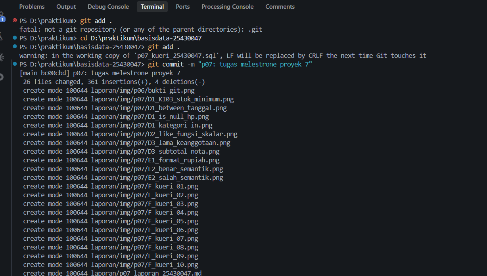

## Checklist

- [x] `p07_kueri_25430047.sql` berisi minimal 10 kueri satu tabel dengan komentar KI
- [x] Bukti screenshot setiap hasil kueri
- [x] Jawaban Titik Analisis D.1, D.2, dan D.3
- [x] Latihan dan Modifikasi (E) selesai
- [x] Milestone Proyek 7: 10 kueri proyek berkomentar KI
- [x] Pembahasan dan kendala selesai
- [x] Kesimpulan selesai
- [ ] Git commit dan push
