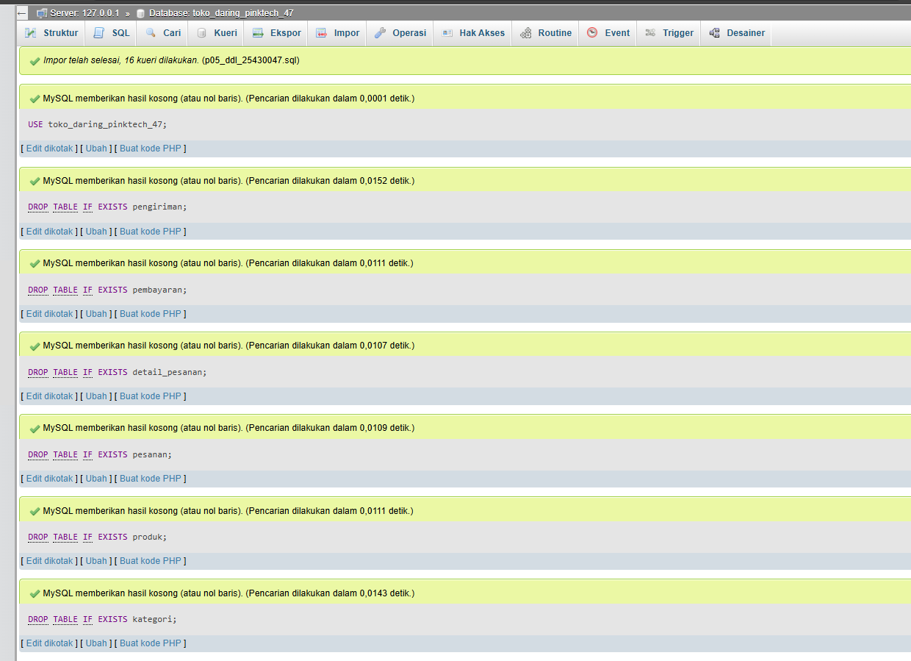
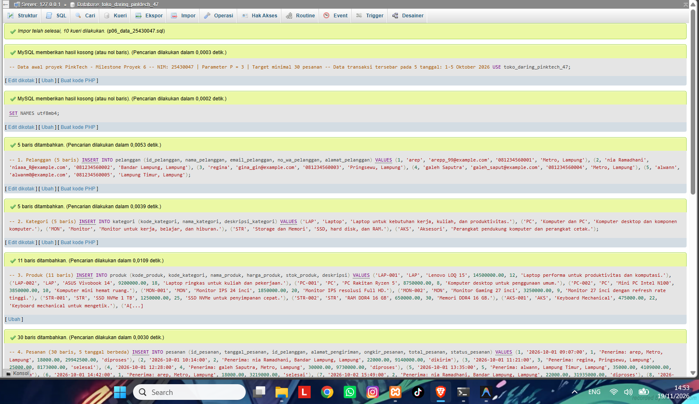
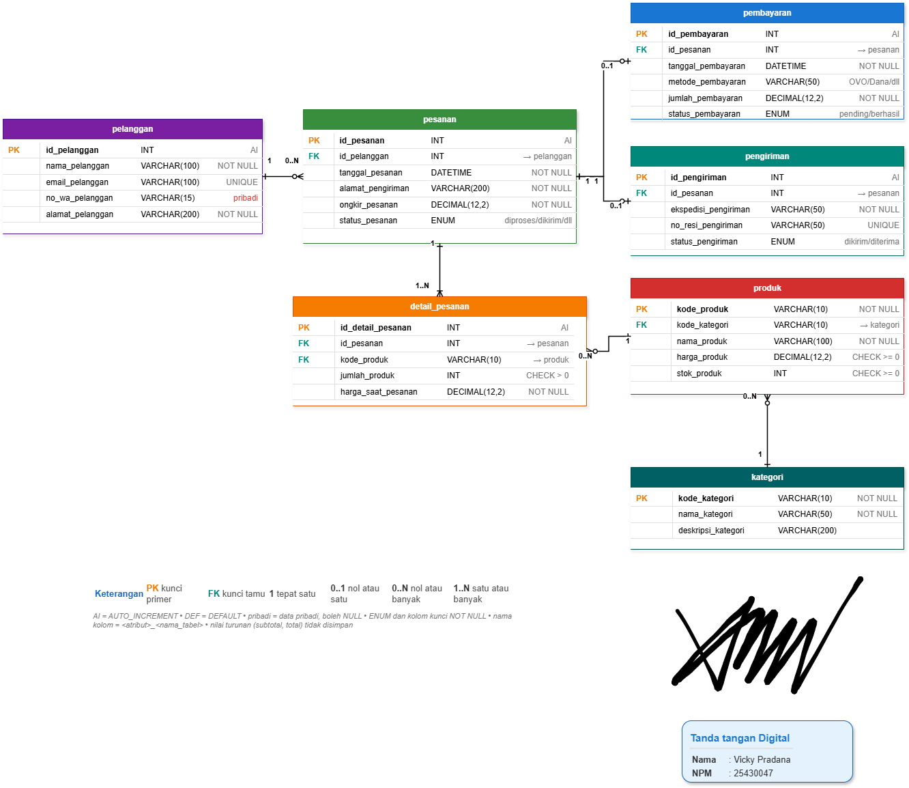
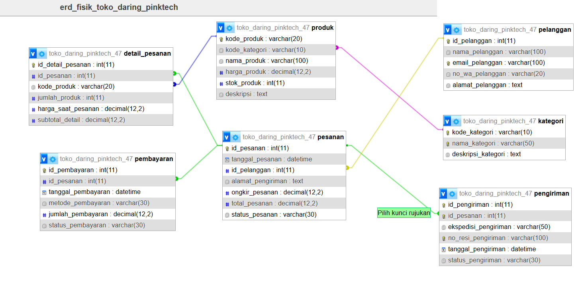
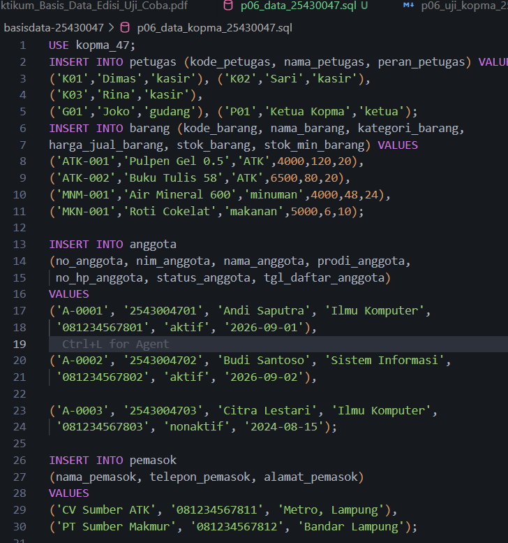
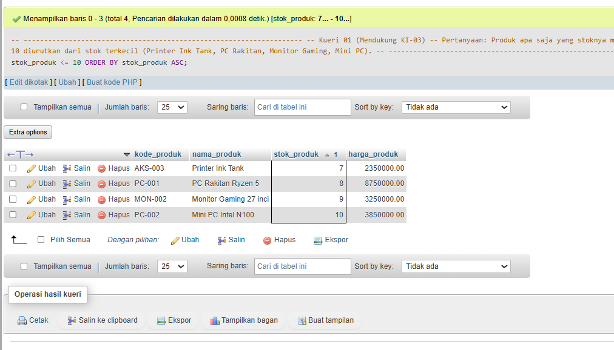
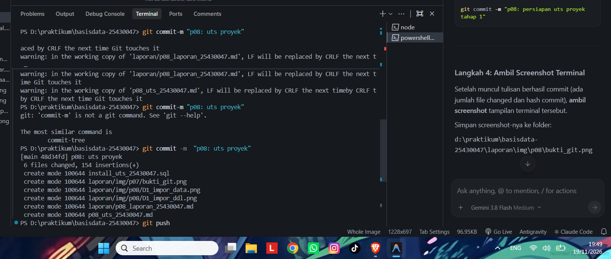

# Laporan Praktikum Basis Data - Pertemuan 08

**Nama:** Vicky Pradana  
**NIM:** 25430047  
**Kelas:** B  
**Tanggal:** 19 November 2026  
**Nama Dosen:** Dedi Irawan, S.Kom., M.T.I.

## 1. Tujuan Praktikum

dari sini mahasiswa bisa menggabungkan seluruh daata yg ada dari pertemuan 1 samapai 7 jadi 1 baris data proyek yg full , bisa buktikan data bisa di pasang ulang dari nol bersih lweat skirp insatalaisi otomatis (install_uts)
dan bisa melakukan demo, modifiakasi langusng di t4 serta bisa tanggung jawabkan desaian basis data saat sesi VIVO

## 2. Ringkasan Dasar Teori

kita menggabungkan data protyek 1 sampai 7

1. intergarasi P1-P7 seluruh tahapan mulai dari kebutuhan data (PA/AB/KI) ,normalisasi 3NF, skirp DLL, isi data semple dan 10 kueri yg konsisten.
2. instalasi bersih , skrip DLL Dan data bisa di jalankan berulang dari nol pada baris kosong pakai skirp install_uts tampa ada galat
3. empat tahapan ujian proyek :
4. persiapan (jalankan skrip instalai berish)
5. demo (nujukain sstruktur , constrint, data sample , 10 kueri)
6. modifikasi (buat / ubah table yg tepat)
7. viva (tanya jawab)

## 3. Hasil Langkah Percobaan


eksekusi impor skrip p05_ddl berhasil dilakukan dari nol, seluruh tabel utama dan constraint dibuat ulang dengan bersih


eksekusi impor skrip p06_data berhasil

## 4. Jawaban Titik Analisis

1. **Alasan Pemilihan Tipe Data:**
   Kolom harga dan biaya seperti `harga_produk`, `ongkir_pesanan`, dan `total_pesanan` memakai tipe `DECIMAL(12,2)` bukan `FLOAT` atau `DOUBLE` untuk mencegah galat pembulatan presisi desimal pada kalkulasi uang toko.
2. **Kardinalitas Relasi:**
   Relasi antara tabel `pesanan` dan `detail_pesanan` adalah `1:N` (one-to-many) karena satu pesanan pelanggan dapat membeli lebih dari satu jenis produk (sesuai AB-02).
3. **Normalisasi & Dependensi Fungsional:**
   Nilai `subtotal_detail` dihitung dari `jumlah_produk * harga_saat_pesanan` dan disimpan sebagai `GENERATED ALWAYS AS ... STORED` agar data tetap konsisten pada 3NF tanpa resiko anomali update.
4. **Refleksi Desain (Aturan Belum Terjaga di Server):**
   Aturan AB-04 (pesanan baru boleh diproses setelah pembayaran berhasil) belum bisa ditegakkan oleh CHECK bawaan karena memeriksa kondisi lintas dua tabel berbeda (`pesanan` dan `pembayaran`). Ini menjadi utang desain yang akan ditangani dengan trigger/stored procedure di Modul 14.

## 5. Hasil Latihan dan Modifikasi

Simulasi permintaan perubahan cepat dari Bank Modifikasi Langsung Butir 1 (menambahkan kolom baru dengan nilai bawaan):

```sql
ALTER TABLE pesanan
ADD COLUMN catatan_pesanan VARCHAR(255) NOT NULL DEFAULT 'Tidak ada catatan';
```

Ketika diuji dengan `SELECT id_pesanan, total_pesanan, catatan_pesanan FROM pesanan LIMIT 3;`, kueri berhasil dijalankan dan seluruh 30 data pesanan lama otomatis memiliki nilai bawaan `'Tidak ada catatan'` tanpa merusak integritas data yang sudah ada.

## 6. Tugas Mandiri: Milestone Proyek 8

Seluruh integrasi milestone dari Pertemuan 1 sampai 7 telah dirangkum dalam berkas pendamping [`p08_uts_25430047.md`](../p08_uts_25430047.md) dan skrip instalasi bersih [`install_uts_25430047.sql`](../install_uts_25430047.sql).

Berikut bukti gambar capaian milestone yang telah diintegrasikan:


diagram ERD relasional hasil normalisasi 3NF pada Milestone 3 dan 4


struktur fisik tabel DDL beserta primary key, foreign key, dan tipe data pada Milestone 5
g

pengisian data master dan data transaksi (30 pesanan) pada Milestone 6


salah satu dari 10 kueri SELECT satu tabel yang menjawab kebutuhan informasi (KI) pada Milestone 7

## 7. Pembahasan dan Kendala

Di pekerjaan tes ini ada kendalanya di mana? Oh kita mau jalanin script yang install UTS itu SQL-nya langsung lewat phpMyAdmin di web. Bingung karena nggak didukung, toh. Jadi cara instalasinya kita bertahap ternyata. Jadi kita pakai file yang di P05. Terus pakai yang di P06. Kita ngimportnya satu-satu untuk isi seluruh data. Hasilnya clear ya, bersih, nggak ada kendala sama sekali. Nggak ada error

## 8. Kesimpulan

Jadi di kesimpulan ini ini disuruh mengintegrasikan, jadi apa, intinya digabungin lah di pertemuan satunya sampai tujuh. Nah itu dalam di data proyek toko daring. Ya proyek kita sendiri. Yang utuh sama ya full lah jadinya. Nah itu ini kita bisa berhasil buktiin datanya itu bisa diulang bersih pakai script DDL yang di pertemuan lima sama datanya itu data tanpa ada galat. Dan kita bisa siap buat demonstrasiin tabel pengujian data, jawab pertanyaan. Nah, sama siap melakukan modifikasi jika diperlukan

## 9. Pernyataan Penggunaan AI

di sini saya menggunakan ai pada modul 8 ini bagian merangkum tujuan dan teori UTS, menyusun skrip instalasi bersih install_uts, menyusun berkas ringkasan proyek p08_uts, serta simulasi titik analisis pertanyaan viva dan modifikasi langsung step by step. AI yang saya gunakan GPT Go dan gemini plus

## 10. Bukti Git



## Checklist

- [x] Berkas `p08_uts_25430047.md` (ringkasan milestone 1–7) dan `install_uts_25430047.sql` tersedia
- [x] Bukti basis data berjalan dari skrip DDL dan data (instalasi bersih)
- [x] Catatan modifikasi langsung saat demo / bank modifikasi
- [x] Refleksi keputusan desain yang akan diperbaiki
- [x] Pembahasan dan kendala selesai
- [x] Kesimpulan selesai
- [x] Pernyataan penggunaan AI selesai
- [ ] Git commit dan push
