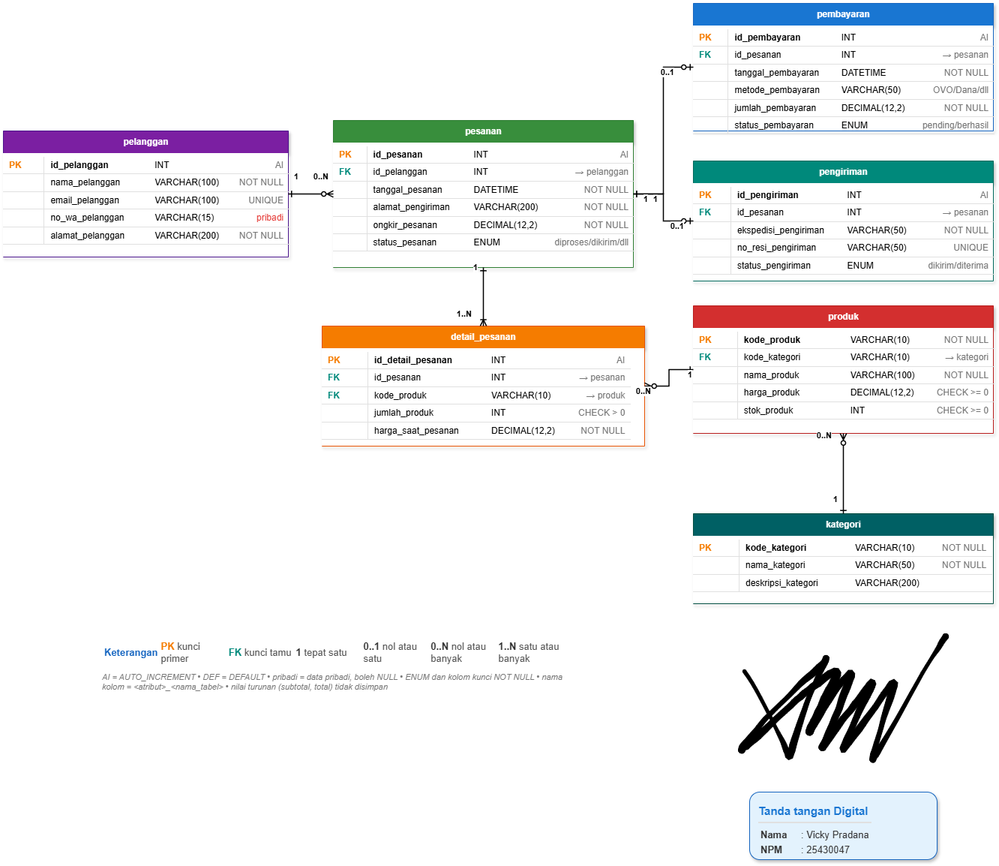

## F. Tugas Mandiri: Milestone Proyek 4

### F.1 Menentukan Dokumen Sumber dan Bentuk UNF

Dokumen sumber yang digunakan adalah Dokumen memuat informasi pelanggan, pesanan, detail produk, harga saat transaksi, alamat pengiriman, dan ongkos kirim yg di p02_kebutuhan_data_25430047

Bentuk UNF awal dituliskan sebagai berikut:

```
PESANAN_UNF (
    id_pesanan,
    tanggal_pesanan,
    id_pelanggan,
    nama_pelanggan,
    alamat_pengiriman,
    ongkir_pesanan,
    {
        kode_produk,
        nama_produk,
        jumlah_produk,
        harga_saat_pesanan,
        subtotal_detail
    },
    total_pesanan,
    status_pesanan
)
```

Grup `{ ... }` menunjukkan detail produk yang dapat berulang dalam satu pesanan Bentuk ini menjadi dasar untuk proses normalisasi berikutnya

### F.2 Menentukan Dependensi Fungsional (FD)

```
FD1: id_pesanan
     -> tanggal_pesanan, id_pelanggan, alamat_pengiriman,
        ongkir_pesanan, status_pesanan (AB-02)

FD2: id_pelanggan
     -> nama_pelanggan, email_pelanggan,
        no_wa_pelanggan, alamat_pelanggan
     (berdasarkan identitas pelanggan di kamus data)

FD3: kode_produk
     -> nama_produk, kategori_produk, harga_produk,
        stok_produk (AB-03)

FD4: (id_pesanan, kode_produk)
     -> jumlah_produk, harga_saat_pesanan (AB-02, AB-05)

FD5: jumlah_produk, harga_saat_pesanan
     -> subtotal_detail (nilai turunan)
```

FD1 dan FD3 ngikutin identitas pesanan dan produk pd dokumen kebutuhan data FD2 ngikutin atribut pelanggan pda kamus data FD4 mengasumsikan satu produk dicatat satu kali dalam 1 pesanan jika produk yang sama boleh muncul di beberapa baris, kita perlu make identitas detail pesanan sebagai kunci. FD5 merupakan perhitungan, bukan kunci tabel

### ### F.3 Tahapan Normalisasi

#### 1. Bentuk Normal Pertama (1NF)

Grup detail produk pda bentuk UNF dihilangkan dengan mencatat setiap produk yg dipesan sebagai satu baris detail Bentuk relasi 1NF dituliskan sebagai berikut:

### F.3.1 Tahap Normalisasi 1NF

| Nama Relasi   | Atribut                                                                                                                                                                                                                             | Kunci                                       |
| ------------- | ----------------------------------------------------------------------------------------------------------------------------------------------------------------------------------------------------------------------------------- | ------------------------------------------- |
| `PESANAN_1NF` | `id_pesanan`, `kode_produk`, `tanggal_pesanan`, `id_pelanggan`, `nama_pelanggan`, `alamat_pengiriman`, `ongkir_pesanan`, `status_pesanan`, `nama_produk`, `jumlah_produk`, `harga_saat_pesanan`, `subtotal_detail`, `total_pesanan` | PK sementara: (`id_pesanan`, `kode_produk`) |

Kunci komposit sementara adalah `(id_pesanan, kode_produk)`, dengan asumsi satu produk dicatat satu kali pda taip pesanan
Setiap baris mewakili satu produk dalam satu pesanan sehingga kelompok produk berulang sudah dipisahkan. Kunci gabungan di atas masih sementara

#### 2. Bentuk Normal Kedua (2NF)

2NF, atribut yg hanya bergantung pda sebagian kunci komposit dipisahkan menjadi relasi tersendiri jadi Hasilnya adalah

### F.3.2 Tahap Normalisasi 2NF

| Nama Relasi      | Atribut                                                                                                                                     | Kunci                                       |
| ---------------- | ------------------------------------------------------------------------------------------------------------------------------------------- | ------------------------------------------- |
| `PESANAN`        | `id_pesanan`, `tanggal_pesanan`, `id_pelanggan`, `nama_pelanggan`, `alamat_pengiriman`, `ongkir_pesanan`, `status_pesanan`, `total_pesanan` | PK: `id_pesanan`                            |
| `PRODUK`         | `kode_produk`, `nama_produk`, `kategori_produk`, `harga_produk`, `stok_produk`                                                              | PK: `kode_produk`                           |
| `DETAIL_PESANAN` | `id_pesanan`, `kode_produk`, `jumlah_produk`, `harga_saat_pesanan`, `subtotal_detail`                                                       | PK sementara: (`id_pesanan`, `kode_produk`) |

tahap 2NF, atribut yg bergantung hanya pada sebagian kunci gabungan dipisahkan ke tabel PESANAN dan PRODUK Tabel DETAIL_PESANAN nyimpan informasi produk yg dipesan, jumlah, dan harga saat transaksi
Kunci primer `PESANAN` adalah `id_pesanan`, kunci primer `PRODUK` adalah `kode_produk`, kolo kunci primer sementara `DETAIL_PESANAN` adalah gabungan `(id_pesanan, kode_produk)`

#### 3. Bentuk Normal Ketiga (3NF)

Pda tahap 3NF, atribut yg bergantung secara transitif dipisahkan ke tabel tersendiri. `nama_pelanggan` dan data pelanggan lainnya disimpan dalam tabel `PELANGGAN`, sedangkan `PESANAN` hanya menyimpan `id_pelanggan` sebagai kunci tamu

### F.3.3 Tahap Normalisasi 3NF

| Nama Relasi      | Atribut                                                                                                                   | Kunci                                       |
| ---------------- | ------------------------------------------------------------------------------------------------------------------------- | ------------------------------------------- |
| `PELANGGAN`      | `id_pelanggan`, `nama_pelanggan`, `email_pelanggan`, `no_wa_pelanggan`, `alamat_pelanggan`                                | PK: `id_pelanggan`                          |
| `PESANAN`        | `id_pesanan`, `tanggal_pesanan`, `id_pelanggan`, `alamat_pengiriman`, `ongkir_pesanan`, `status_pesanan`, `total_pesanan` | PK: `id_pesanan`; FK: `id_pelanggan`        |
| `PRODUK`         | `kode_produk`, `nama_produk`, `kategori_produk`, `harga_produk`, `stok_produk`                                            | PK: `kode_produk`                           |
| `DETAIL_PESANAN` | `id_pesanan`, `kode_produk`, `jumlah_produk`, `harga_saat_pesanan`, `subtotal_detail`                                     | PK sementara: (`id_pesanan`, `kode_produk`) |

tahap 3NF, data pelanggan dipisahkan ke tabel PELANGGAN agar atribut seperti nama, email, nomor Wa, dan alamat pelanggan bergantung langsung pda kunci utama id_pelanggan Tabel PESANAN tetap menyimpan alamat_pengiriman karna alamat tujuan pesanan dapat beda dari alamat utama pelanggan

### F.3.4 Pemeriksaan BCNF

BCNF (Boyce-Codd Normal Form) terpenuhi apabila setiap determinan pada dependensi fungsional nontrivial merupakan superkey.

| Nama Relasi      | Determinan          | Hasil Pemeriksaan       | Alasan                                                                                                  |
| ---------------- | ------------------- | ----------------------- | ------------------------------------------------------------------------------------------------------- |
| `PELANGGAN`      | `id_pelanggan`      | Memenuhi BCNF           | `id_pelanggan` merupakan kunci utama yang menentukan atribut pelanggan lainnya.                         |
| `PESANAN`        | `id_pesanan`        | Memenuhi BCNF           | `id_pesanan` merupakan kunci utama yang menentukan atribut pesanan lainnya.                             |
| `PRODUK`         | `kode_produk`       | Memenuhi BCNF sementara | `kode_produk` menentukan atribut produk. Pemeriksaan lanjutan diperlukan jika terdapat dependensi lain. |
| `KATEGORI`       | `kode_kategori`     | Memenuhi BCNF sementara | `kode_kategori` menentukan nama dan deskripsi kategori.                                                 |
| `DETAIL_PESANAN` | `id_detail_pesanan` | Memenuhi BCNF sementara | `id_detail_pesanan` digunakan sebagai calon kunci utama untuk setiap baris detail pesanan.              |

### F.4 Keputusan Penyimpanan Nilai Turunan

| Nilai Turunan     | Rumus                                            | Keputusan                                | Alasan                                                                                                                       |
| ----------------- | ------------------------------------------------ | ---------------------------------------- | ---------------------------------------------------------------------------------------------------------------------------- |
| `subtotal_detail` | `jumlah_produk * harga_saat_pesanan`             | Tidak disimpan, dihitung saat dibutuhkan | Nilai dapat dihitung dari jumlah produk dan harga saat transaksi sehingga menghindari inkonsistensi data.                    |
| `total_pesanan`   | `total seluruh subtotal_detail + ongkir_pesanan` | Tidak disimpan, dihitung saat dibutuhkan | Total pesanan dapat dihitung dari detail pesanan dan ongkos kirim sehingga tidak perlu menyimpan hasil perhitungan berulang. |

Nilai turunan bisa dihitung saat dibutuhkan agar tidak jadi ketidaksesuaian apabila jumlah produk, harga saat transaksi, atau ongkos kirim berubah harga_saat_pesanan tetap disimpan karna mencatat harga produk pada saat transaksi, sesuai aturan bisnis AB-05

### F.5 Perubahan ERD

| No. | Perubahan                                                               | Alasan                                                    |
| --- | ----------------------------------------------------------------------- | --------------------------------------------------------- |
| 1   | Memisahkan data pelanggan dari pesanan.                                 | Menghindari pengulangan data pelanggan.                   |
| 2   | Memisahkan kategori ke tabel `KATEGORI`.                                | Data kategori dikelola secara terpisah dari produk.       |
| 3   | Menambahkan `id_detail_pesanan` sebagai calon PK pada `DETAIL_PESANAN`. | Mengidentifikasi setiap baris detail pesanan secara unik. |
| 4   | Menghubungkan `PESANAN` dengan `PELANGGAN`.                             | Setiap pesanan terkait dengan pelanggan.                  |
| 5   | Menghubungkan `DETAIL_PESANAN` dengan `PESANAN` dan `PRODUK`.           | Menunjukkan produk yg terdapat dalam setiap pesanan.      |

yg udah di rubah di erd
Tabel Kategori: Menambahkan entitas kategori dengan kode_kategori sebagai PK
Tabel Produk: Mengubah PK menjadi kode_produk (menghapus id_produk) dan menambahkan kode_kategori sebagai FK
Tabel Detail Pesanan: Menambahkan id_detail_pesanan sebagai PK dan mengubah relasi produk menjadi kode_produk (FK saja, bukan bagian dari komposit PK)
Relasi: Menambahkan garis relasi 1 to 0..N dari kategori ke produk
buktinya ada di folder img

