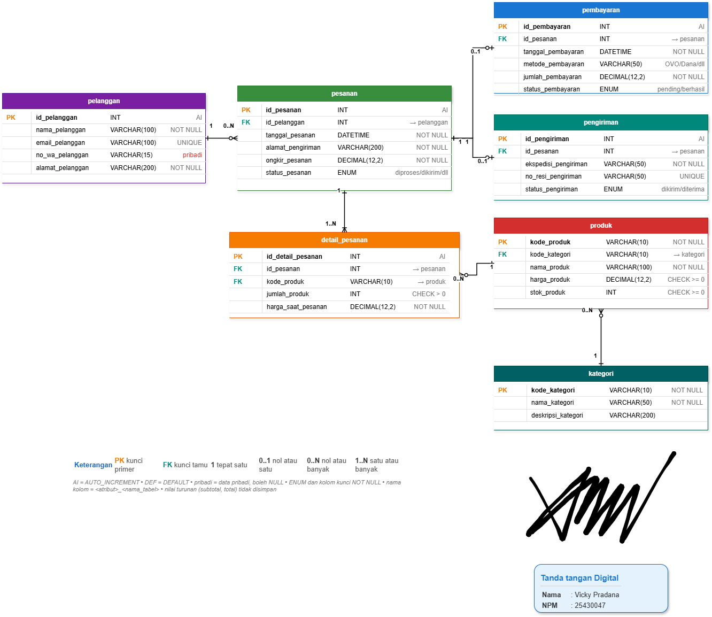
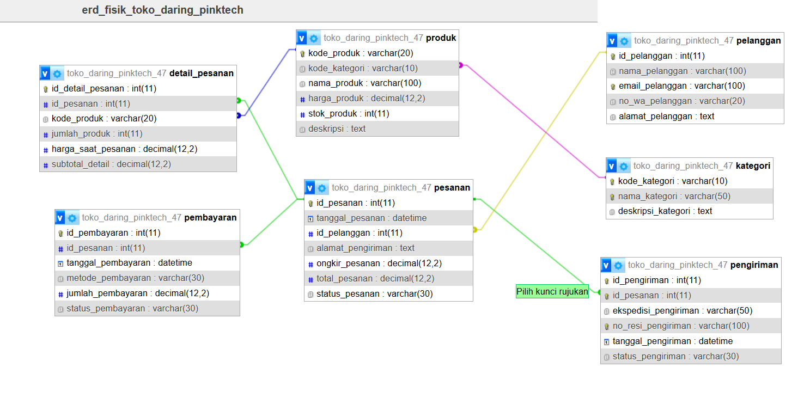
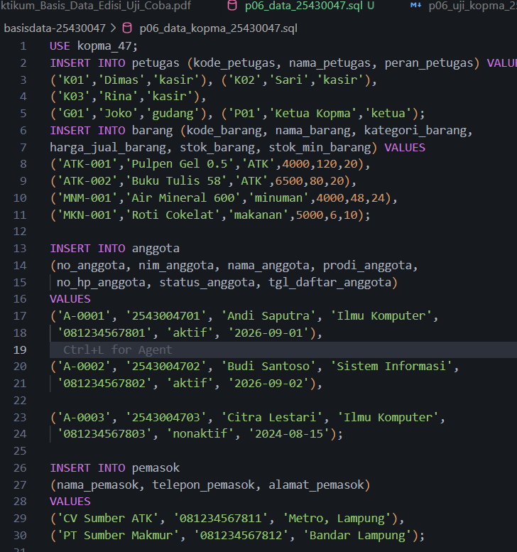

# Ringkasan Milestone Proyek Tahap 1 (UTS) - PinkTech
**Nama:** Vicky Pradana  
**NIM:** 25430047  
**Kelas:** B  
**Tema Proyek:** Toko Daring Perangkat Komputer dan Teknologi (PinkTech)  
**Basis Data:** `toko_daring_pinktech_47`  

---

## 1. Peta Integrasi Milestone 1–7

| Pertemuan / Milestone | Nama Berkas Utama | Deskripsi & Komponen yang Dihasilkan | Status |
|:---:|---|---|:---:|
| **M1: Lingkungan** | [`p01_lingkungan_25430047.sql`](p01_lingkungan_25430047.sql), [`README.md`](README.md) | Pembuatan basis data, akun kerja `mhs_047`, hak akses, dan `.gitignore`. | ✅ Selesai |
| **M2: Kebutuhan Data** | [`p02_kebutuhan_data_25430047.md`](p02_kebutuhan_data_25430047.md) | 5 Proses Bisnis (PB), 9 Aturan Bisnis (AB), 6 Kebutuhan Informasi (KI), Matriks CRUD, dan Kamus Data (P = 3). | ✅ Selesai |
| **M3: Perancangan ERD** | [`p03_erd_25430047.drawio`](p03_erd_25430047.drawio) | Diagram ERD konseptual 7 entitas utama beserta relasi dan kardinalitas. | ✅ Selesai |
| **M4: Normalisasi** | [`p04_normalisasi_25430047.md`](p04_normalisasi_25430047.md) | Tahapan normalisasi data UNF $\rightarrow$ 1NF $\rightarrow$ 2NF $\rightarrow$ 3NF dan diagram skema relasi terupdate. | ✅ Selesai |
| **M5: DDL Basis Data** | [`p05_ddl_25430047.sql`](p05_ddl_25430047.sql) | Skrip pembuatan 7 tabel fisik, tipe data, kunci primer/asing, dan batasan `CHECK`. | ✅ Selesai |
| **M6: Data & Pengujian** | [`p06_data_25430047.sql`](p06_data_25430047.sql), [`p06_uji_25430047.md`](p06_uji_25430047.md) | Pengisian data master & transaksi (30 pesanan), serta 10 skenario pengujian constraint (positif & negatif). | ✅ Selesai |
| **M7: Kueri Analisis** | [`p07_kueri_25430047.sql`](p07_kueri_25430047.sql) | 10 kueri `SELECT` satu tabel menggunakan `LIKE`, `BETWEEN`, `IN`, `IS NULL`, `CASE`, dan fungsi skalar. | ✅ Selesai |
| **M8: Instalasi Bersih** | [`install_uts_25430047.sql`](install_uts_25430047.sql) | Skrip master otomatis untuk membangun ulang DDL dan Data proyek dari nol. | ✅ Selesai |

---

## 2. Parameter Proyek (NIM Akhir: 47)
* **Digit Terakhir (P):** 3
* **Target Data Transaksi:** Minimal 30 pesanan (tersebar pada 5 tanggal transaksi: 1–5 Oktober 2026).
* **Entitas Utama:** `pelanggan`, `kategori`, `produk`, `pesanan`, `detail_pesanan`, `pembayaran`, `pengiriman`.

---

## 3. Bukti Visual Desain Basis Data

### Diagram ERD Relasional (3NF)

### Struktur Fisik DDL (Tabel, Tipe Data & Relasi)

### Sampel Data Transaksi Teruji (30 Pesanan)

---

## 4. Catatan Refleksi & Utang Desain
* Aturan bisnis **AB-04** (*pesanan hanya boleh diproses setelah pembayaran berstatus berhasil*) belum dapat ditegakkan secara utuh oleh constraint `CHECK` di tingkat DDL tabel tunggal. Batasan ini dicatat sebagai utang desain yang akan ditangani dengan mekanisme *Trigger* pada Modul 14.
